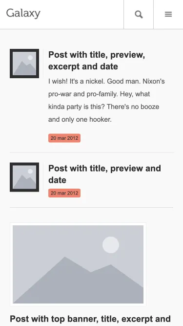

# Galaxy Light

Galaxy Light: a blog template for phones, with a single-post view, contact page and typography reference.

**[Live demo](https://mobifreaks.munawarahmed.com/Galaxy-Mobi-Light/)** ·
[Download zip](https://github.com/mobifreaks/Galaxy-Mobi-Light/archive/HEAD.zip) ·
[All 22 templates](https://munawarahmed.com/mobifreaks)

## Use it

No build step. Download the zip, open `index.html`, and replace the placeholder text and images with your own.

## Tech

HTML, CSS and jQuery 1.12.

## License

MIT, see [LICENSE](LICENSE). Keeping the "Design by Mobifreaks" credit in the footer is appreciated, not required.

---

Built by [Mobifreaks](https://munawarahmed.com/mobifreaks), the first project of [M Munawar Ahmed](https://munawarahmed.com).
